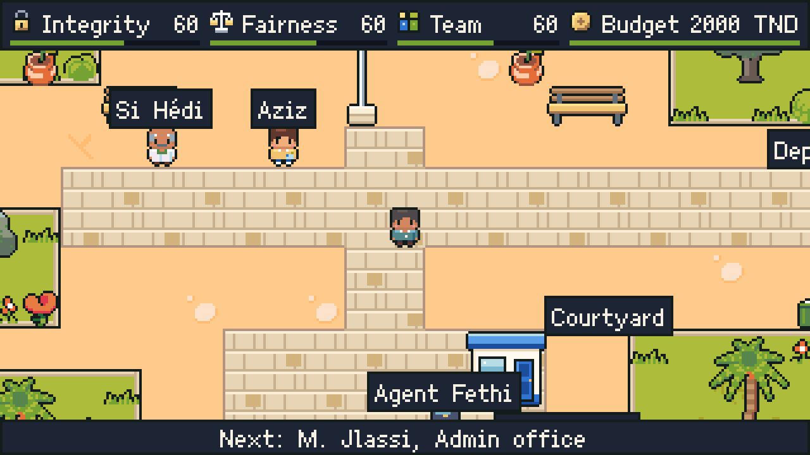

# BA 400 PM Game

**Play it:** <https://aminbadh.github.io/ba400-pm-game/> (laptop, or a phone held sideways)

A class learns project quality and staffing plans by running one together. You are the project manager of exam centre 26 for the Tunisian baccalauréat 2026. Each conversation teaches a part of the chapter on a concept card, then the room votes on what to do with A, B and C cards. Every vote moves four meters (Integrity, Fairness, Team, Budget) and pays off on exam day, where the region's report checks your plan against the charter and a debrief names the best answer to each vote.

Made for a class presentation in a project management course. A full play takes about 30 minutes.

## Controls

| Action | Keys | Controller | Touch |
| --- | --- | --- | --- |
| Move | WASD or arrows | Left stick or D-pad | On-screen D-pad |
| Talk, advance, confirm | E, Space or Enter | ✕ | Talk, or tap the line |
| Vote | 1, 2, 3, or Up/Down then E | Up/Down, then ✕ | Tap the option |
| Binder of cards | B | △ to open, ○ to close | Binder |
| Pause menu | Escape | Start | Menu |

The hints on screen follow whichever device was used last. The pause menu also has sound, full screen, a controller check and a skip to the next scene.

## Run it

Open `project.godot` in [Godot 4.7](https://godotengine.org/) (standard build, not .NET) and press F5.

`tools/web_build.sh <godot> <folder>` imports the project, runs every test under `tests/` (the story to each ending, the map's routes, controls and touch, colour contrast, layout) and exports the web build. Every push to `main` runs it on GitHub Actions and publishes the result to GitHub Pages. The Windows build is the `Windows` export preset: one executable with the game inside.

The story is in `dialogue/` (one [Dialogue Manager](https://github.com/nathanhoad/godot_dialogue_manager) file per scene), the cards, report and charts in `content/`, and the art is drawn by the Python scripts in `tools/` (run with [uv](https://docs.astral.sh/uv/)).

## Credits

- [Ark Pixel Font](https://github.com/TakWolf/ark-pixel-font) by TakWolf, 10 px proportional, Latin build: SIL Open Font License 1.1 ([`fonts/OFL.txt`](fonts/OFL.txt)).
- [Dialogue Manager](https://github.com/nathanhoad/godot_dialogue_manager) by Nathan Hoad: MIT licence ([`addons/dialogue_manager/LICENSE`](addons/dialogue_manager/LICENSE)).
- [Ninja Adventure Asset Pack](https://pixel-boy.itch.io/ninja-adventure-asset-pack) by Pixel-boy and AAA: floors, plants, some furniture, the voices and the music. Creative Commons Zero v1.0 Universal ([`art/ninja_adventure/LICENSE.txt`](art/ninja_adventure/LICENSE.txt)); the files used are listed in [`art/LICENSES.md`](art/LICENSES.md).
- The lycée's walls, doors, furniture, trees, the characters, portraits and UI were drawn for this project, in the pack's palette.
- Every person in the story is fictional. The story draws on the real Bac 2026, but no real statistic appears in it.
